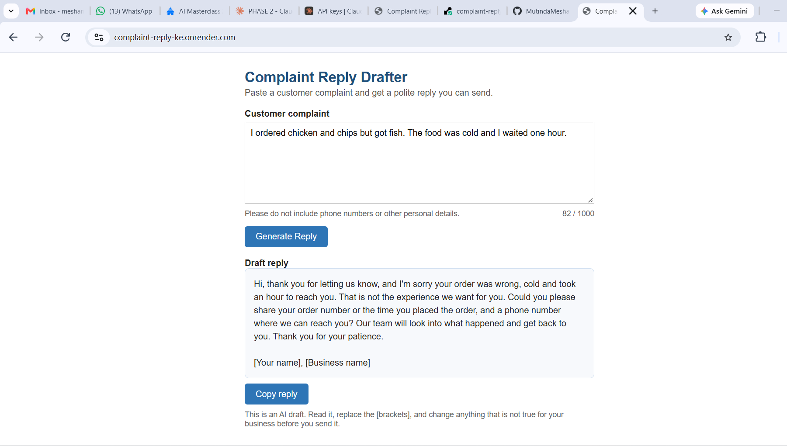

# Complaint Reply Drafter

**Live demo:** https://complaint-reply-ke.onrender.com/
*(The demo runs on a free server. If it has been idle, the first load can take about a minute.)*

A web tool for small businesses that get customer complaints on WhatsApp. Paste the complaint, click Generate Reply, and get a polite draft that acknowledges the problem and offers a clear next step, without blaming anyone or promising things the business hasn't agreed to.

## Who it helps
Shops, courier services, Airbnb hosts and restaurants that want to reply well without spending 20 minutes writing each message.

## How it works
1. The page sends the complaint to a Flask API.
2. The API sends it to Claude with a system prompt that sets the rules: polite, no blame, no refunds or exact times promised, one clear next step, sign-off left for the owner to fill in.
3. The draft comes back to the page. The owner reviews it, fills in the [brackets], and sends it.

Serious complaints (illness, injury, theft, legal threats) get a short, careful reply with a note telling the owner to handle it personally.

## Stack
Python, Flask, Claude (Anthropic API), HTML and JavaScript. Deployed on Render.

## Run locally
```bash
pip install -r week4/complaint-reply/requirements.txt
```
Create a `.env` file in the project root:
```
ANTHROPIC_API_KEY=your_key_here
```
```bash
python week4/complaint-reply/app.py
```
Open http://127.0.0.1:5000

## Example


## Protecting the demo
- The API key lives only in Render's environment settings and never reaches the browser.
- Each visitor is limited per hour, and the whole demo has a daily cap, so a public link can't run up a large bill.
- Complaints are limited to 1,000 characters, and nothing the user types is stored or logged.

## Limits
- It's an AI draft, so the owner must read it before sending. It may get facts or Swahili wording wrong.
- It doesn't know the business's policies, so it never promises refunds or times.
- Complaints are sent to the Claude API. Do not paste phone numbers or other personal details.
- The free server sleeps when idle, and the limits are kept in memory, so they reset when it restarts.