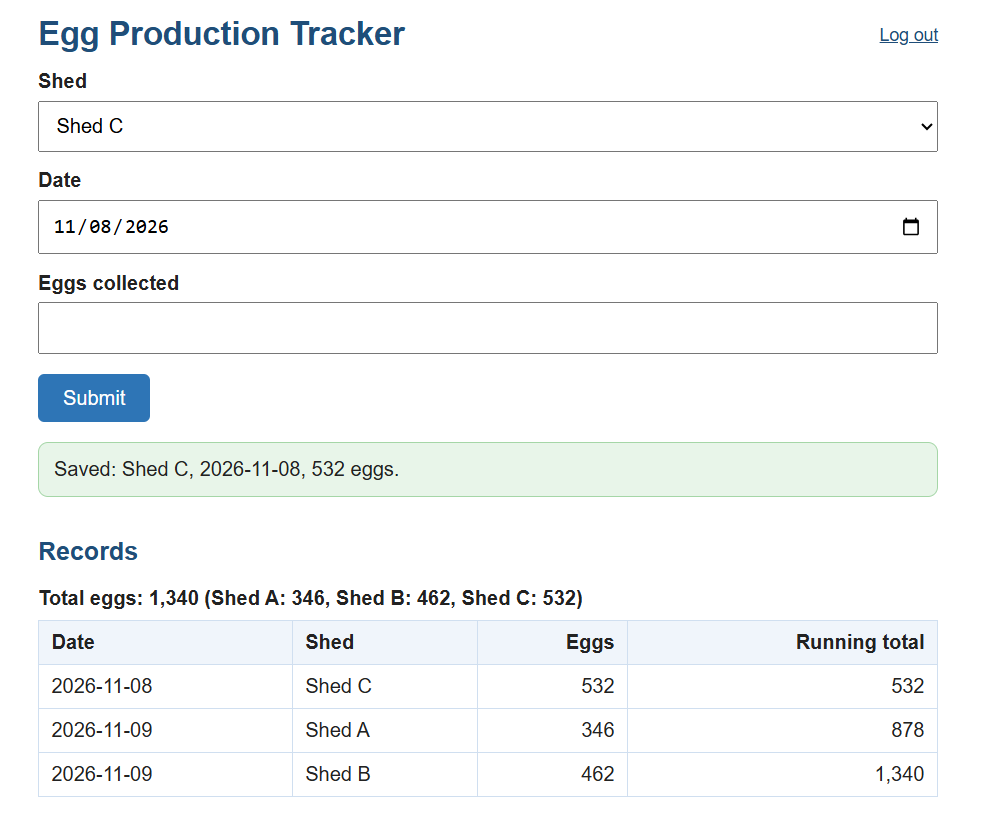

# Egg Production Tracker API

A small REST API for a poultry farmer with three sheds. He logs each shed's daily egg count and reads the totals at the end of the week, instead of adding up WhatsApp messages by hand.

## Live Demo
https://egg-tracker-guss.onrender.com/

The free host puts the app to sleep when idle, so the first load can take about a minute. Records are kept in memory and are cleared when the app restarts or sleeps. Login details are not published.

## Endpoints
Both need the header `X-API-Key`.

| Method | URL | What it does |
|---|---|---|
| POST | `/api/eggs` | Log a day's count: `{"shed": "Shed A", "date": "2026-11-02", "count": 420}` |
| GET | `/api/eggs` | All records, each with a running total, plus the grand total and totals by shed |
| GET | `/api/eggs?from=2026-11-02&to=2026-11-08` | The same, for one week |

Errors return JSON with a message: 400 (bad data), 401 (wrong key), 404, 405, and 409 (a record for that shed and date already exists).

## Web page
1. Start the server and open http://127.0.0.1:5000
2. Log in with the password from your `.env` file.
3. Choose a shed and a date, enter the count, and press Submit.
4. The records and totals appear on the page.

The page talks to the Flask server, and the server talks to the API with the key. The farmer never needs the key.


## Setup
1. Install Python 3.
2. Install the libraries:
   ```bash
   pip install -r week4/egg-tracker/requirements.txt
   ```
3. Create a `.env` file in the project root with a long random key:
   ```
   EGGS_API_KEY=your_key_here
   EGGS_ADMIN_PASSWORD=your_value_here
   FLASK_SECRET_KEY=your_key_here
   
   ```

## Run
```bash
python week4/egg-tracker/app.py
```
In a second terminal, run the checks:
```bash
python week4/egg-tracker/test_api.py
```

## Deployment
Deployed on Render (free tier) from this repository.

| Setting | Value |
|---|---|
| Root Directory | `week4/egg-tracker` |
| Build Command | `pip install -r requirements.txt` |
| Start Command | `gunicorn app:app --workers 1 --bind 0.0.0.0:$PORT` |

- `EGGS_API_KEY`, `EGGS_ADMIN_PASSWORD` and `FLASK_SECRET_KEY` are set in Render's Environment tab, with different values from my local `.env`. They are never in the code or on GitHub.
- One worker is used on purpose, because records live in memory and several workers would each keep a separate list.
- Every push to `main` redeploys the app.


## Example response
```
--- Valid records ---
[ok  ] Shed A yesterday: expected 201, got 201
       {"count":420,"date":"2026-11-08","id":1,"shed":"Shed A"}
[ok  ] Shed B yesterday: expected 201, got 201
       {"count":385,"date":"2026-11-08","id":2,"shed":"Shed B"}
[ok  ] Shed A today: expected 201, got 201
       {"count":410,"date":"2026-11-09","id":3,"shed":"Shed A"}
[ok  ] Shed B today: expected 201, got 201
       {"count":395,"date":"2026-11-09","id":4,"shed":"Shed B"}
[ok  ] Zero eggs is valid (Shed C): expected 201, got 201
       {"count":0,"date":"2026-11-09","id":5,"shed":"Shed C"}
```

## Security
- The API key never reaches the browser. It stays on the server, and the browser only holds a login session.
- The session cookie is `HttpOnly` and `SameSite=Lax`.
- CORS is deliberately not enabled.
- The live demo is served over HTTPS by Render. Local runs use plain `http://127.0.0.1`.

## Limits
- Records are kept in memory and are lost when the app restarts or the free host puts it to sleep. A real deployment needs a database.
- One shared API key and one shared password, with no individual logins.
- The shed names in `app.py` are examples. Replace them with the farmer's real names.
- The wrong-password delay is not real protection against guessing. A real version needs proper rate limiting.
- There is no way yet to correct or delete a wrong record.
- The free host is slow to wake after idle time.

## Price
- **Build and deploy:** KES 30,000 one-off. Includes the API, saving records permanently in a database (not just in memory), a simple weekly-summary page, deployment, and a one-hour handover.
- **Monthly:** KES 2,500. Includes hosting, daily backups, and support within 2 working days.